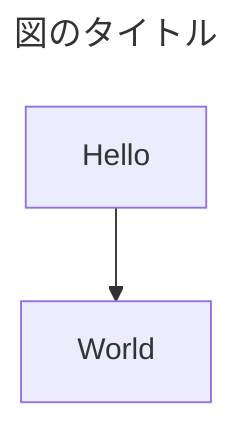

# AGENTS.md — boleto-client-go ドキュメント執筆ガイド

**目的: AI Agent が boleto-client-go に関するドキュメントを書くとき、一貫した粒度・トーン・書式・判断基準で出力するためのガードレール。**

このファイルは「何を書くか」ではなく「どう書くか」を定義する。技術的な決定の正本は `adr/` 配下の ADR を参照すること。コーディング時の行動指針はリポジトリルートの `AGENTS.md` を参照する (本ファイルはドキュメント執筆に限る)。

***

## 1. プロジェクト概要 (Context)

執筆前に最低限把握しておくべき前提。

- **組織階層** — 親会社 **Japanticket Holdings Inc.** の傘下に **Ebisol** / **JapanTicket** / **JapanTicket PRESTIGE (JTP)** の 3 子会社。本リポジトリは GitHub の `ebisol` Organization 配下にあり、JTP の開発チームが主導する。
- **Boleto** — JapanTicket の予約・販売システム。Shop / 商品 / 在庫 / 注文のマスタを保持する。外部連携先 (OTA) 向けに **Boleto OpenAPI** を公開している。Swagger 定義の OpenAPI ではなく、JapanTicket が「外部公開 API」の意味で使っている名称。
- **boleto-client-go** — Boleto OpenAPI 向けの Go クライアント SDK。各事業側サービスが Boleto を呼び出すときの HTTP クライアント・認証トークン管理・エラー処理・冪等性を 1 か所に閉じ込める。
- **SDK の構成方針** — 依存は標準ライブラリのみ、型付きエラー、操作ごとのリトライ既定、`mise` タスクでの lint / test、`examples/` にモック Boleto と参照実装、という構成を採る。逸脱するときは ADR で理由を残す。
- **執筆者の立場** — JTP の開発リーダー。AI Agent への依頼は原則として開発リーダー視点の意思決定を支援するもの。
- **SDK の責務境界**
  - SDK が担う: 認証 (`/auth/token` でのアクセストークン取得と更新)、必須ヘッダの自動付与、HTTP エラー → 型付きエラーへの変換、Boleto のエラーコード (例: キャンセル時の `2006` 系は冪等成功扱い) の解釈、操作ごとのリトライ既定、ページング補助
  - SDK が担わない: 利用側の注文・予約の状態管理、`externalOrderId` / `externalProductId` の採番と永続化、在庫ホールド期限と利用側の決済期限のギャップ調整、Shop・商品の同期戦略
- **詳細は以下を参照**
  - `adr/` — 設計原則・個別の技術選定理由 (技術決定の正本)
  - `Glossary.md` — 用語と固有名詞 (必ず参照する)

***

## 2. ディレクトリ構成とドキュメント種別

ディレクトリ構成・ドキュメント種別・ライフサイクル・配置の判断ルールは `README.md` を参照する (このファイルでは扱わない)。

新規ドキュメントを書くときは、まず `README.md` で配置先と種別を確定すること。

***

## 3. 執筆原則 (Writing Principles)

- **言語** — 本文は日本語。技術用語 (SDK, Idempotency-Key, Bearer, Webhook 等) と Boleto OpenAPI のフィールド名 (`externalOrderId`, `tentativeOrderId` 等) は英語のまま使う。無理に和訳しない。
- **トーン** — 事実ベース、断定的。過剰な敬語・前置きは避ける。「〜と考えられます」より「〜である」「〜とする」。
- **結論先出し** — 各セクション冒頭に結論。理由・詳細はその後。
- **比較は表で** — 「手書きクライアント vs SDK」「GET vs 派生コマンド」のような対比は必ず表。箇条書きで並列に書かない。
- **根拠を添える** — 「なぜこの選択か」を必ず併記。Boleto 側の仕様に基づく判断は出典 URL と確認日を添える。
- **1 ファイル 1 トピック** — API 群 (認証 / Shop・商品 / 在庫 / 注文) ごとにファイルを分ける。1 ファイルで SDK 全体を語らない。

### 設計ドキュメントの書き分け

SDK のため、各事業側サービスで書くような「基本設計 (ビジネス側向け)」は原則不要。読者は開発チームと各事業側サービスの開発者に限る。

| 種別            | 読者                   | 役割                           | 書く内容                                                               | 書かない内容                         |
| ------------- | -------------------- | ---------------------------- | ------------------------------------------------------------------ | ------------------------------ |
| SDK 全体設計      | 開発チーム + 利用側開発者        | SDK の骨格と横断的関心事を 1 枚で共有       | パッケージ構成、公開 API の形、認証・エラー・冪等性・リトライの横断方針、利用側との責務境界                   | 個別 API の型定義・フィールドマッピング         |
| API 群ごとの詳細設計  | 開発チーム                | プログラマが迷わず実装できる粒度に落とす          | 対応エンドポイント、Go の型とメソッド、Boleto エラーコード → SDK エラーのマッピング、リトライ可否、テスト観点 | 全体設計の内容を重複させず、参照で繋ぐ             |
| 仕様調査 (research) | 開発チーム                | Boleto 側の契約を確認日付きで写し取る        | エンドポイント、パラメータ、制約 (件数上限・期間上限・必須項目)、エラーコード、出典 URL、確認日             | SDK 側の設計判断 (それは design / ADR に書く) |

書き分けのルール:

- **詳細設計は対応する research を前提**とし、冒頭でその research へリンクする。research に無い API 仕様を詳細設計で断定しない。
- ADR 級の意思決定 (リトライ既定、依存ゼロ方針、エラー型の形、トークン更新戦略) は設計書本文に埋め込まず、`adr/` に起票して設計書から参照する。

***

## 4. 書式・Markdown 規約

- ドキュメントは **Markdown で記述する**。
- **ファイル名・ディレクトリ名は、使ってよい文字だけで付ける**。リポジトリ内のファイルはすべて Go のモジュール zip に入り、使えない文字が 1 つでもあると、利用側が `go get` で SDK を取得できなくなる。
  - 使ってよい: 半角英数字、漢字・ひらがな・カタカナ (長音 `ー` を含む)、半角スペース、半角記号 `! # $ % & ( ) + , - . = @ [ ] ^ _ { } ~`
  - 使ってはいけない (例): `・`、全角の記号・括弧・句読点・スペース・数字 (`「」（）【】、。：／～〜　１` など)、丸数字 (`①`)、絵文字、半角記号 `"` `'` `*` `/` `:` `;` `<` `>` `?` `\` `` ` `` `|`
  - 語の区切りには `_` を使う (例: `Shop_商品_詳細設計.md`)
- ファイル間リンクは相対パス (`./adr/0001-xxx.md`)。外部出典 (Confluence 等) はファイル末尾に `> 出典: [タイトル](URL) (確認日: YYYY-MM-DD)` 形式で記載する。
- **コードブロックには言語指定を必ず付ける** ( ` ```go `, ` ```sh `, ` ```json `, ` ```yaml ` 等)。図示用の ASCII art も ` ``` ` で囲む。
- **図の優先順位は Mermaid > ASCII art > 画像**。API 呼び出しの流れは `sequenceDiagram` を使い、SDK が担う部分を `Note` で明示する。Mermaid はソースを Markdown 内に直接書き、別ファイルにしない。
- **Mermaid には必ずタイトルを付ける**。コードの冒頭に front-matter 形式で `title` を記述する。タイトルなしの Mermaid は書かない。



- **Boleto OpenAPI のエンドポイントは `メソッド パス` の形で書く** (例: `POST /orders/reserve`)。API 名 (例: `Get_shops_API_v2`) を併記するときはコードスパンで囲む。
- **秘密情報は書かない**。API キー・クライアントシークレット・アクセストークンの実値は、例示でもドキュメントに載せない。環境変数名やプレースホルダ (`<API_KEY>`) で表現する。

***

## 5. テンプレート参照

| 種別        | テンプレ / 雛形                                                                                                                                                                              |
| --------- | -------------------------------------------------------------------------------------------------------------------------------------------------------------------------------------- |
| ADR       | `adr/README.md` の Format にあるテンプレートをコピーして使う。メタデータ (status / date / superseded_by) は YAML frontmatter ではなく本文冒頭のリストに書き、Context / Decision / Options considered / Consequences / Advice (任意) の構成を崩さない |
| SDK 全体設計  | 解決する課題 (手書きで起きること vs SDK での解決、表) → 処理フロー (sequenceDiagram) → パッケージ構成 → 横断方針 → 利用側の責務                                                                                                 |
| 詳細設計      | 対応 research へのリンク → 対応エンドポイント一覧 → 型とメソッド → エラーマッピング (表) → リトライ可否 → テスト観点 → 未決事項                                                                                                       |
| 仕様調査      | 用語 → 前提 → 仕様サマリー (表: API / エンドポイント / 主要パラメータ / 主要制約) → 重要な気づき → 出典 (確認日付き)                                                                                                                              |
| 実装計画      | 目的 → スコープ → 非スコープ → 完了条件 → タスク分解 → リスクの順                                                                                                                                       |
| Runbook   | 前提 → 手順 (番号付き) → 検証 → ロールバック → 既知の問題                                                                                                                                                   |

新規ファイルを書くときは、まず該当する既存ファイルを 1 つ読み、構成を踏襲する。独自構成を採用するときはその理由を冒頭に書く。

***

## 6. クロスリファレンスと用語管理

### ファイル間リンク

- リポジトリ内のリンクは相対パス
- ADR から他 ADR を参照するときは `ADR-0001` の形式 + 相対パスを併記
- Supersede 関係は旧 ADR の status を `superseded` に変更し、`superseded_by: "NNNN"` を追記する。新 ADR 側には書かない

### Boleto 側ドキュメントと本リポジトリの関係

|         | Boleto 側 (Confluence)         | 本リポジトリ `docs/`              |
| ------- | ---------------------------- | --------------------------- |
| 役割      | Boleto OpenAPI 契約の正本         | SDK の設計・計画・運用の正本。契約は確認日付きの写し |
| 更新主体    | JapanTicket 開発チーム            | JTP 開発チーム + AI Agent          |
| 乖離時の扱い  | 正                            | `research/` の確認日を更新し、影響する設計書・ADR を洗い出す |

### 用語管理

- `Glossary.md` **を必ず参照する**。既出語の意味を勝手に推測しない
- 新出の固有名詞 (Boleto 側のエンティティ名、エラーコード、環境名、社内略語) が出てきたら **その場で** `Glossary.md` **に追記する**
- 用語と固有名詞の定義は AGENTS.md には書かない。Glossary が一元管理

***

## 7. AI Agent への指示 (Operating Instructions)

### 新規ドキュメント作成時

1. ユーザーの要求から該当するドキュメント種別と配置先を `README.md` で特定する
2. §5 で対応するテンプレ / 既存ファイルを開き、構成を確認する
3. `Glossary.md` を読み、登場する固有名詞の意味を確定する
4. 不明点は **一つずつ** ユーザーに確認する (複数の質問を一度に投げない)
5. 推測で技術選定を書かない。既存の ADR / research / Glossary に根拠がない断定はしない
6. 出典 URL があれば末尾に記載する

### Boleto OpenAPI の仕様を書くとき (必須)

- **記述前に必ず正本を確認する**。エンドポイント・パラメータ・制約・エラーコードは学習データや各事業側サービスの写しだけに依存せず、Confluence の該当ページを確認する。アクセスできない場合はその旨を明記し、参照した写しの確認日を併記する。
- 確認した仕様は `research/` に確認日付きで記録してから設計に使う。
- 各事業側サービスが調査済みの論点 (在庫ホールド既定 5 分と決済期限のギャップ、`2006` 系の冪等成功扱い、orderer 姓名の半角英字制約など) は、SDK が解決するか利用側に残すかを明示する。

### 技術関連の詳細を書くとき (必須)

- **記述前に必ず最新情報を確認する**。Go のバージョン、標準ライブラリの挙動、`staticcheck` 等のツール仕様は学習データだけに依存しない。
- 確認手段: 公式ドキュメントの Web 検索 / Fetch、リリースノート、`go.mod` / `mise.toml` 等のプロジェクトの依存定義ファイル。
- 引用元の URL と確認日 (`YYYY-MM-DD`) をドキュメント末尾の出典セクションに記載する。
- 古い情報のまま書かれた既存箇所を見つけた場合は、その旨をユーザーに報告してから更新する。

### 既存ドキュメント更新時

1. なぜ更新するかを最初にユーザーに 1 行で説明する
2. ADR の本文は不変が原則 (変更してよいのは status と、superseded にするときの `superseded_by` の追記のみ)。差分は新 ADR を起票する
3. Boleto 側の契約変更に伴う更新は、影響を受ける research / 設計書 / ADR を洗い出してから着手する
4. 用語の意味が変わる場合は `Glossary.md` も同時に更新する

### 質問の仕方

- 複雑なタスクは **着手前に方針を提示して承認を取る**
- 質問は一つずつ
- 曖昧な要求は推測せず、選択肢を提示して選んでもらう

***

## 8. やってはいけないこと (Anti-patterns)

- **Boleto OpenAPI の仕様を推測で書く** — フィールド名・エラーコード・制約値は正本か確認日付きの research に根拠があるものだけを書く
- **利用側の責務を SDK に取り込む提案** — 注文状態管理、ID の採番・永続化、同期戦略は SDK の責務外 (§1)。取り込みたい衝動が出たら責務境界の ADR を先に議論する
- **外部依存の追加を独断で提案** — 依存ゼロ方針 (§1) からの逸脱は ADR で議論する話
- **リトライ既定を操作の性質を見ずに一律に書く** — 参照系 / 受付系 / 派生コマンドで既定を分ける。「状態不明」を成功にも失敗にも倒さない
- **出典なしの断定** — 「一般的に〜」「ベストプラクティス的には〜」だけで方針を確定しない。出典 URL か既存 ADR を引く
- **自分のローカルにしか存在しないファイルを出典にする** — 他のリポジトリをローカルに clone したパス、作業用ディレクトリ、個人のメモなどは読者が辿れないので出典にしない。出典は読者全員がアクセスできるものに限る
  - 本リポジトリ内のファイル → 相対パスで書いてよい (同じリポジトリを見ている人は全員アクセスできる)
  - 他のリポジトリのファイル → ブラウザで開ける URL (GitHub の blob URL 等) で書く。可能ならコミット SHA 付きの permalink にする
  - Confluence 等の外部ドキュメント → URL と確認日を書く
- **テンプレ無視の独自構成** — 既存テンプレを使わないなら理由を冒頭に書く
- **秘密情報の記載** — API キー・シークレット・トークンの実値は例示でも書かない
- **体制の記載** — 開発体制・人数・担当者などのチーム構成はドキュメントに書かない
- **絵文字 / 過度な装飾** — 業務ドキュメントでは使わない
- **長すぎる 1 ファイル** — API 群ごとに分割する。1 ファイルで SDK 全部を語ろうとしない
- **Glossary を更新せず固有名詞を本文に登場させる** — 必ず Glossary に登録してから使う

***

> このファイル自体の更新ルール: 執筆ルールに変更が必要になったらこのファイルを更新する。プロジェクト固有の技術決定はこのファイルには書かず、ADR / 設計書に書く。

> 出典: [Go Modules Reference — File path and size constraints](https://go.dev/ref/mod#zip-path-size-constraints) (確認日: 2026-10-06)
