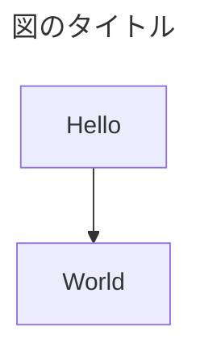

# AGENTS.md — akapen ドキュメント執筆ガイド

**目的: AI Agent が akapen に関するドキュメントを書くとき、一貫した粒度・トーン・書式・判断基準で出力するためのガードレール。**

このファイルは「何を書くか」ではなく「どう書くか」を定義する。技術的な決定の正本は `adr/` 配下の ADR を参照すること。コーディング時の行動指針はリポジトリルートの `AGENTS.md` を参照する (本ファイルはドキュメント執筆に限る)。

***

## 1. プロジェクト概要 (Context)

執筆前に最低限把握しておくべき前提。

- **akapen** — 対象ディレクトリのドキュメントとコードを複数人がブラウザで閲覧し、行・ブロック単位でコメントとリプライを付け、そのスレッドを Coding Agent 向けのプロンプトとしてコピーする CLI / Web アプリ。名前は「赤ペン」に由来する。
- **構成方針** — Bun の単一バイナリ、依存は最小限 (サーバー `markdown-it` / `shiki` / `ignore`、クライアント `react` / `react-dom` / `mermaid` / `dompurify`)、対象ディレクトリは読み取り専用、データは `~/.config/akapen/` のみに書く。逸脱するときは ADR で理由を残す。
- **利用の前提** — 通話などでその場にいる同僚と、URL と起動ごとの 6 桁の PIN を共有して使う (ADR-0007)。アカウントによる認証は持たない。リモート共有の手段 (HTTPS の終端など) は Tailscale などに任せる。
- **akapen の責務境界**
  - akapen が担う: ファイル一覧と表示、Markdown の Preview と行マッピング、コメントの永続化とリアルタイム配信、プロンプトの生成とコピー、セッションの管理、PIN による閲覧の制限とブラウザ経由の攻撃への最低限の対策
  - akapen が担わない: ファイルの編集、Coding Agent の起動や直接連携 (v2 候補)、アカウントによる認証、HTTPS の終端、Git の操作
- **詳細は以下を参照**
  - `adr/` — 設計原則・個別の技術選定理由 (技術決定の正本)
  - `design/要件.md` — 要件 ID (F1〜F13 / A1〜A4) の正本
  - `Glossary.md` — 用語と固有名詞 (必ず参照する)

***

## 2. ディレクトリ構成とドキュメント種別

ディレクトリ構成・ドキュメント種別・ライフサイクル・配置の判断ルールは `README.md` を参照する (このファイルでは扱わない)。

新規ドキュメントを書くときは、まず `README.md` で配置先と種別を確定すること。

***

## 3. 執筆原則 (Writing Principles)

- **言語** — 本文は日本語。技術用語 (WebSocket, SPA, CLI 等) とコード上の識別子 (`anchor_text`, `Bun.serve` 等) は英語のまま使う。無理に和訳しない。UI の文言は英語なので、画面の文言を引用するときは英語のまま書く。
- **トーン** — 事実ベース、断定的。過剰な敬語・前置きは避ける。「〜と考えられます」より「〜である」「〜とする」。
- **結論先出し** — 各セクション冒頭に結論。理由・詳細はその後。
- **比較は表で** — 「markdown-it vs Bun.markdown」「github: vs packslip:」のような対比は必ず表。箇条書きで並列に書かない。
- **根拠を添える** — 「なぜこの選択か」を必ず併記。ライブラリやツールの仕様に基づく判断は、出典 URL と確認日を添える。
- **1 ファイル 1 トピック** — 設計はトピック (ファイル表示 / API / セキュリティ / セッションなど) ごとにファイルを分ける。1 ファイルで akapen 全体を語らない (全体像は `design/全体設計.md` のみ)。

### 設計ドキュメントの書き分け

読者は開発者 (人と AI Agent) に限る。

| 種別            | 読者                   | 役割                           | 書く内容                                                               | 書かない内容                         |
| ------------- | -------------------- | ---------------------------- | ------------------------------------------------------------------ | ------------------------------ |
| 全体設計      | 開発者        | akapen の骨格と横断的関心事を 1 枚で共有       | 解決する課題、プロセス構成、技術選定、主な処理の流れ、ソースの構成、横断方針                   | トピックごとの仕様の詳細         |
| トピックごとの設計  | 開発者                | 迷わず実装・テストできる粒度に落とす          | 対象の要件、仕様 (規則・形式・振る舞い)、テスト観点、未決事項 | 全体設計の内容を重複させず、参照で繋ぐ。型の詳細は `src/shared/` を正本にする             |
| 技術調査 (research) | 開発者                | ライブラリ・ツール・ブラウザの仕様を確認日付きで写し取る        | 仕様、制約、手元での実測結果、確度 (確認済 / 要検証)、出典 URL、確認日             | akapen 側の設計判断 (それは design / ADR に書く) |

書き分けのルール:

- **設計は対応する research を前提**とし、冒頭でその research へリンクする。research に無い仕様を設計で断定しない。
- ADR 級の意思決定 (ランタイム、保存方式、配布方式、セキュリティモデル) は設計書本文に埋め込まず、`adr/` に起票して設計書から参照する。

***

## 4. 書式・Markdown 規約

- ドキュメントは **Markdown で記述する**。
- **ファイル名・ディレクトリ名は、使ってよい文字だけで付ける**。GitHub・各 OS・シェルで扱いやすくするため。
  - 使ってよい: 半角英数字、漢字・ひらがな・カタカナ (長音 `ー` を含む)、半角スペース、半角記号 `! # $ % & ( ) + , - . = @ [ ] ^ _ { } ~`
  - 使ってはいけない (例): `・`、全角の記号・括弧・句読点・スペース・数字 (`「」（）【】、。：／～〜　１` など)、丸数字 (`①`)、絵文字、半角記号 `"` `'` `*` `/` `:` `;` `<` `>` `?` `\` `` ` `` `|`
  - 語の区切りには `_` を使う (例: `保存先とセッション.md`、`M1_ツリーとコード表示_詳細計画.md`)
- ファイル間リンクは相対パス (`./adr/0001-xxx.md`)。外部出典はファイル末尾に `> 出典: [タイトル](URL) (確認日: YYYY-MM-DD)` 形式で記載する。
- **コードブロックには言語指定を必ず付ける** ( ` ```ts `, ` ```sh `, ` ```json `, ` ```toml ` 等)。図示用の ASCII art も ` ```text ` で囲む。
- **図の優先順位は Mermaid > ASCII art > 画像**。ブラウザとサーバーのやりとりは `sequenceDiagram` を使う。Mermaid はソースを Markdown 内に直接書き、別ファイルにしない。
- **Mermaid には必ずタイトルを付ける**。コードの冒頭に front-matter 形式で `title` を記述する。タイトルなしの Mermaid は書かない。



- **akapen の API は `メソッド パス` の形で書く** (例: `POST /api/threads`)。
- **秘密情報は書かない**。トークン・PAT の実値は、例示でもドキュメントに載せない。環境変数名やプレースホルダ (`<TOKEN>`) で表現する。

***

## 5. テンプレート参照

| 種別        | テンプレ / 雛形                                                                                                                                                                              |
| --------- | -------------------------------------------------------------------------------------------------------------------------------------------------------------------------------------- |
| ADR       | `adr/README.md` の Format にあるテンプレートをコピーして使う。メタデータ (status / date / superseded_by) は YAML frontmatter ではなく本文冒頭のリストに書き、Context / Decision / Options considered / Consequences / Advice (任意) の構成を崩さない |
| 全体設計  | 解決する課題 (今のやり方 vs akapen での解決、表) → 構成 (flowchart) → 技術選定 (表) → 主な処理の流れ (sequenceDiagram) → ソースの構成 → 横断方針                                                                                                 |
| トピックごとの設計      | 目的 (太字の 1 文) → 対応する research / 要件へのリンク → 仕様 → テスト観点 (該当する場合) → 未決事項 (ある場合)                                                                                                       |
| 技術調査      | 用語 (必要な場合) → 前提 (調査日・凡例・検証環境) → 仕様サマリー (表) → 重要な気づき → 出典 (確認日付き)                                                                                                                              |
| 実装計画      | 目的 → スコープ → 非スコープ → 完了条件 → タスク分解 → リスクの順                                                                                                                                       |
| Runbook   | 前提 → 手順 (番号付き) → 検証 → ロールバック → 既知の問題                                                                                                                                                   |

新規ファイルを書くときは、まず該当する既存ファイルを 1 つ読み、構成を踏襲する。独自構成を採用するときはその理由を冒頭に書く。

***

## 6. クロスリファレンスと用語管理

### ファイル間リンク

- リポジトリ内のリンクは相対パス
- ADR から他 ADR を参照するときは `ADR-0001` の形式 + 相対パスを併記
- Supersede 関係は旧 ADR の status を `superseded` に変更し、`superseded_by: "NNNN"` を追記する。新 ADR 側には書かない

### ドキュメントとコードの関係

|         | `docs/`         | コード (`src/`)              |
| ------- | ---------------------------- | --------------------------- |
| 正本      | 要件・設計の規則・決定の理由         | API とイベントの型 (`src/shared/`)、実際の振る舞い |
| 乖離時の扱い  | 意図した仕様なら設計書が正。コードを直す                            | 設計書に無い詳細はコードが正。必要なら設計書に追記する |

### 用語管理

- `Glossary.md` **を必ず参照する**。既出語の意味を勝手に推測しない
- 新出の固有名詞 (akapen 固有の概念、画面の名前、状態の名前) が出てきたら **その場で** `Glossary.md` **に追記する**
- 用語と固有名詞の定義は AGENTS.md には書かない。Glossary が一元管理

***

## 7. AI Agent への指示 (Operating Instructions)

### 新規ドキュメント作成時

1. ユーザーの要求から該当するドキュメント種別と配置先を `README.md` で特定する
2. §5 で対応するテンプレ / 既存ファイルを開き、構成を確認する
3. `Glossary.md` を読み、登場する固有名詞の意味を確定する
4. 不明点は **一つずつ** ユーザーに確認する (複数の質問を一度に投げない)
5. 推測で技術選定を書かない。既存の ADR / research / Glossary に根拠がない断定はしない
6. 出典 URL があれば末尾に記載する

### 技術関連の詳細を書くとき (必須)

- **記述前に必ず最新情報を確認する**。Bun のバージョンと API、ライブラリ (markdown-it / Shiki / Mermaid 等) の挙動、mise や GitHub Actions の仕様は学習データだけに依存しない。
- 確認手段: 公式ドキュメントの Web 検索 / Fetch、リリースノート、`@types/bun` に同梱のドキュメント、手元での実行、`package.json` / `bun.lock` / `mise.toml` 等のプロジェクトの依存定義ファイル。
- 引用元の URL と確認日 (`YYYY-MM-DD`) をドキュメント末尾の出典セクションに記載する。手元で実行して確かめたものは、その旨と環境 (OS・バージョン) を書く。
- 古い情報のまま書かれた既存箇所を見つけた場合は、その旨をユーザーに報告してから更新する。

### 既存ドキュメント更新時

1. なぜ更新するかを最初にユーザーに 1 行で説明する
2. ADR の本文は不変が原則 (変更してよいのは status と、superseded にするときの `superseded_by` の追記のみ)。差分は新 ADR を起票する
3. 仕様の変更に伴う更新は、影響を受ける research / 設計書 / ADR / 計画を洗い出してから着手する
4. 用語の意味が変わる場合は `Glossary.md` も同時に更新する

### 質問の仕方

- 複雑なタスクは **着手前に方針を提示して承認を取る**
- 質問は一つずつ
- 曖昧な要求は推測せず、選択肢を提示して選んでもらう

***

## 8. やってはいけないこと (Anti-patterns)

- **ライブラリやツールの仕様を推測で書く** — API・オプション・制約は、公式ドキュメントか確認日付きの research に根拠があるものだけを書く
- **akapen の責務外の機能を取り込む提案** — ファイルの編集、アカウントによる認証、Agent の直接連携は v1 の責務外 (§1)。取り込みたい衝動が出たら、要件と ADR を先に議論する
- **外部依存の追加を独断で提案** — 依存最小の方針 (§1、ADR-0001) からの逸脱は ADR で議論する話
- **対象ディレクトリへの書き込みを前提にした設計** — akapen は読み取り専用。書き込むのは `~/.config/akapen/` のみ
- **出典なしの断定** — 「一般的に〜」「ベストプラクティス的には〜」だけで方針を確定しない。出典 URL か既存 ADR を引く
- **自分のローカルにしか存在しないファイルを出典にする** — 他のリポジトリをローカルに clone したパス、作業用ディレクトリ、個人のメモなどは読者が辿れないので出典にしない。出典は読者全員がアクセスできるものに限る
  - 本リポジトリ内のファイル → 相対パスで書いてよい (同じリポジトリを見ている人は全員アクセスできる)
  - 他のリポジトリのファイル → ブラウザで開ける URL (GitHub の blob URL 等) で書く。可能ならコミット SHA 付きの permalink にする
  - 外部ドキュメント → URL と確認日を書く
- **テンプレ無視の独自構成** — 既存テンプレを使わないなら理由を冒頭に書く
- **秘密情報の記載** — トークン・PAT の実値は例示でも書かない
- **体制の記載** — 開発体制・人数・担当者などのチーム構成はドキュメントに書かない。例に出す Nickname は `Alice` / `Bob` などの架空の名前にする
- **絵文字 / 過度な装飾** — 業務ドキュメントでは使わない
- **長すぎる 1 ファイル** — トピックごとに分割する。1 ファイルで akapen 全部を語ろうとしない
- **Glossary を更新せず固有名詞を本文に登場させる** — 必ず Glossary に登録してから使う

***

> このファイル自体の更新ルール: 執筆ルールに変更が必要になったらこのファイルを更新する。プロジェクト固有の技術決定はこのファイルには書かず、ADR / 設計書に書く。
