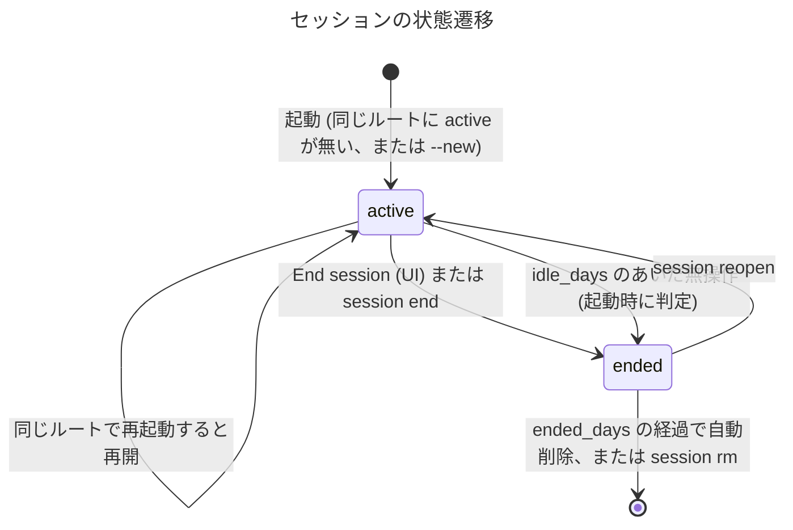

# 保存先とセッション

**目的: コメントを保存する場所、セッションの単位とライフサイクル、多重起動の防止、削除ポリシーを定める。**

- 対象の要件: F11 / F13 ([要件.md](./要件.md))
- データベースの中身は [データモデル.md](./データモデル.md)、設定値は [設定ファイル.md](./設定ファイル.md) を参照

***

## ディレクトリ構成

```text
~/.config/akapen/                      # $XDG_CONFIG_HOME が設定されていれば $XDG_CONFIG_HOME/akapen/
├── config.toml                         # 任意。ユーザーが編集する設定
└── sessions/
    ├── .gitignore                      # 中身は "*"。~/.config を dotfiles として Git 管理していても混入しない
    └── 20261023-1530-project-3f9a/     # セッション ID = 作成日時 + ルート名 + 乱数 4 桁
        ├── session.json                # メタ情報 (一覧・削除の判定はこれだけ読めば済む)
        ├── review.db                   # SQLite (threads / comments)。-wal / -shm も同じ場所に置く
        └── server.lock                 # 起動中のみ存在する (pid / host / port / startedAt)
```

- 場所の優先順位: 環境変数 `AKAPEN_HOME` > `$XDG_CONFIG_HOME/akapen` > `~/.config/akapen`。`AKAPEN_HOME` はテストや一時的な利用向け
- セッションごとにディレクトリを分ける理由: 削除がディレクトリごとの削除で済む / セッション間で SQLite のロックが干渉しない / 1 つ壊れても他に影響しない
- 厳密な XDG の流儀ではデータは `~/.local/share` に置くが、「設定もデータも 1 か所にあり、消すときに迷わない」ことを優先して `~/.config/akapen/` にまとめる (macOS でも `~/Library/Application Support` は使わない)
- パーミッション: ディレクトリは `0700`、ファイルは `0600` (コメントに機密が含まれうるため)
- セッション ID のルート名の部分は、ルートのディレクトリ名を `[a-z0-9-]` に正規化し、32 文字で切ったもの (空になったら `root`)

`session.json` の例:

```json
{
  "schemaVersion": 1,
  "id": "20261023-1530-project-3f9a",
  "root": "/Users/me/work/project",
  "status": "active",
  "createdAt": "2026-10-23T15:30:12+09:00",
  "lastActiveAt": "2026-10-24T10:12:40+09:00",
  "endedAt": null,
  "appVersion": "0.1.0"
}
```

`root` はルートの realpath。日時はローカルのタイムゾーン付きの ISO 8601。

***

## ライフサイクル



1. **起動**: ルートの realpath を求め、`sessions/*/session.json` から `status = "active"` かつ同じ `root` のものを探す
   - 見つかった → そのセッションを再開する
   - 見つからない → 新しく作る
   - `--new` → 既存の active を `ended` にしてから新しく作る
   - `--session <id>` → 指定したセッションを開く (`ended` なら read-only で閲覧する)
2. **多重起動の防止**: `server.lock` があり、その pid が生きていて、`http://<host>:<port>/api/health` が同じセッション ID を返す場合は、新しく起動せずに既存の URL を出して終了する (`--open` ならブラウザで開く)。pid が死んでいるか、応答が違う場合はロックを掃除して続ける
3. **活動の記録**: コメントの書き込みや WebSocket の接続のたびに `lastActiveAt` を更新する (1 分に 1 回まで)
4. **終了**: UI の End session (確認のモーダルで「先にプロンプトをコピー」「JSONL を書き出す」を案内する) か `akapen session end`。全クライアントに `session.ended` を配信し、以後は read-only のバナーを出す。サーバーは Ctrl+C まで閲覧用に動き続ける
5. **再開**: 終了したセッションは `akapen session reopen <id>` で active に戻せる (同じルートに別の active が無い場合のみ)
6. **スキーマの移行**: `session.json` の `schemaVersion` と SQLite の `PRAGMA user_version` で管理し、開くときに順番にマイグレーションする

`session.json` の書き込みは、同じディレクトリの一時ファイルに書いてから rename する (途中で落ちても壊れないようにするため)。

***

## 削除ポリシー

| 種類 | タイミング | 内容 |
|------|-----------|------|
| 自動終了 | 起動時 (全セッションが対象) | `lastActiveAt` から `retention.idle_days` (既定 60 日) 無操作の active を `ended` にする。いきなり消さずに 2 段階にする |
| 自動削除 | 起動時 (全セッションが対象) | `endedAt` から `retention.ended_days` (既定 14 日) を過ぎた `ended` を削除する。ルートのディレクトリが消えているセッションも `ended` にする |
| 手動削除 | 任意 | `akapen session rm <id...>`、`akapen session prune [--dry-run]` |
| 削除しないもの | 常に | ロック中 (起動中) のセッション |

- 削除はセッションのディレクトリの再帰削除 (ゴミ箱は使わない)。消す前に残したい場合は `akapen export --session <id> --format jsonl` で書き出す
- 自動で削除したときは、起動のログに 1 行出す (例: `Pruned 2 ended sessions (3.1 MB)`)
- `idle_days` / `ended_days` を `0` にすると、その自動処理は行わない

***

## テスト観点

- `AKAPEN_HOME` / `XDG_CONFIG_HOME` / 既定の順に場所が決まる
- 同じルートで 2 回起動すると、同じセッションが再開される。`--new` では前のものが `ended` になり、新しいものができる
- `--session <id>` で `ended` を開くと read-only になる
- ロックの pid が生きていて `/api/health` が同じ ID を返すとき、2 回目の起動は既存の URL を出して終了する。pid が死んでいればロックを掃除して起動する
- prune: `idle_days` / `ended_days` の境界、`0` で無効、ロック中は対象外、ルートが消えたセッションは `ended` になる
- 作成したディレクトリとファイルのパーミッションが `0700` / `0600`、`sessions/.gitignore` が作られる
