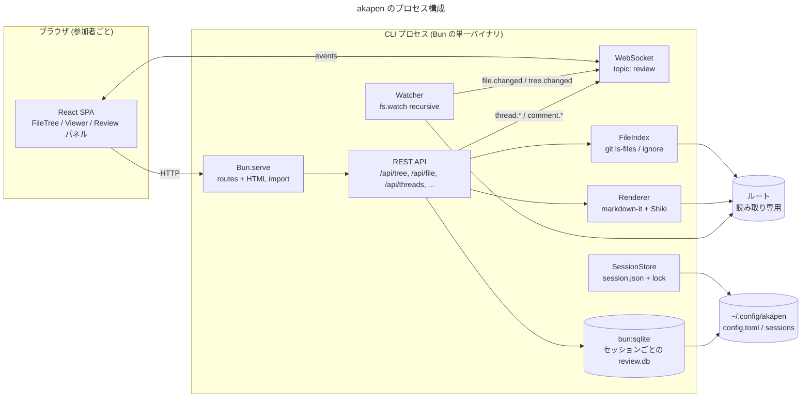
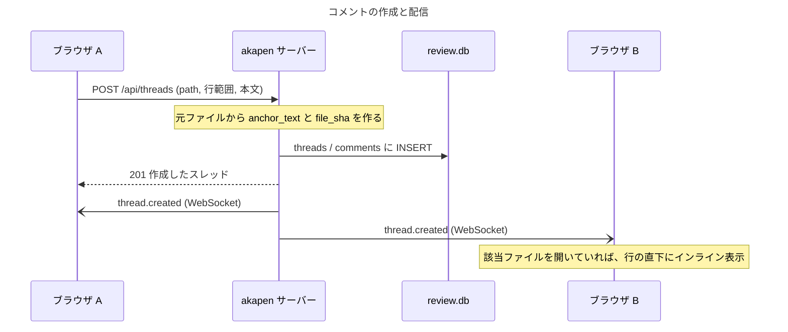
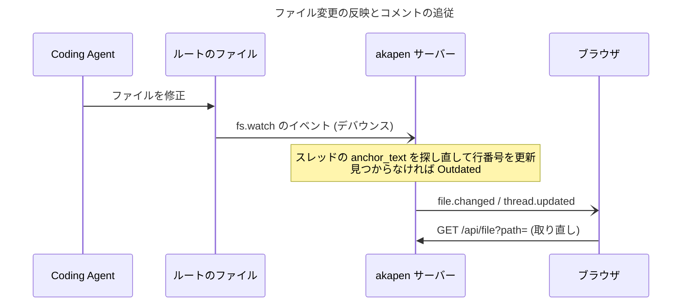

# 全体設計

**目的: akapen の骨格 (プロセス構成、技術選定、主な処理の流れ、ソースの構成、横断方針) を 1 枚で共有する。個別の仕様は各設計書に分け、ここからリンクする。**

> 構成について: `docs/AGENTS.md` の「SDK 全体設計」テンプレートは SDK 向け (利用側の責務など) のため、本書は「解決する課題 → 構成 → 技術選定 → 処理の流れ → ソースの構成 → 横断方針」の順にする。

***

## 解決する課題

| 今のやり方 | 困ること | akapen での解決 |
|-----------|---------|----------------|
| Coding Agent が書いたドキュメントを各自のエディタで読み、気づいた点をチャットに書く | どのファイルの何行目の話かが曖昧になる。複数人の指摘が散らばる | 同じ画面を全員で見ながら、行・ブロックにひも付けてコメントする |
| 指摘をまとめて Agent に渡すときに、手で整形する | 手間がかかり、行番号や対象テキストが抜ける | スレッドから決まった形式のプロンプトを生成してコピーする ([プロンプト出力仕様.md](./プロンプト出力仕様.md)) |
| Agent が修正した結果を確認する | ファイルを開き直す必要がある。前のコメントの位置がずれる | ファイルの変更を監視して画面を更新し、コメントの位置を追従させる |

***

## 構成

CLI のプロセスが 1 つで、HTTP / WebSocket のサーバーと、ファイルの読み取り・レンダリング・永続化をすべて担う。ブラウザは参加者ごとに SPA を開く。



***

## 技術選定

| 領域 | 採用 | 理由 / 代替案 | 調査 |
|------|------|--------------|------|
| ランタイム / サーバー | Bun 1.4 の `Bun.serve` | HTML import でフロントエンドのバンドルまで面倒を見る (Vite 不要)。WebSocket の pub/sub も内蔵 | [Bun_調査.md](../research/Bun_調査.md) |
| CLI 引数 | `node:util` の `parseArgs` | 依存ゼロ。サブコマンド (`export` / `session` / `config`) は自前の振り分けで足りる | — |
| フロントエンド | React 19 + TypeScript | Bun が TSX と CSS の import を直接バンドルできる | — |
| Markdown | markdown-it 15 | `token.map` で全ブロックの行範囲が取れる。`Bun.markdown` は行情報を返さないため v1 では使わない | [レンダリング_調査.md](../research/レンダリング_調査.md) |
| コードハイライト | Shiki 4 | VS Code と同じ TextMate 文法で GitHub に近い見た目。サーバー側でレンダリングし、`(path, mtime)` でキャッシュする | [レンダリング_調査.md](../research/レンダリング_調査.md) |
| Mermaid | Mermaid 12 (クライアント) | DOM が必要なためブラウザで描画する。Mermaid を含むファイルを開いたときだけ動的 import する | [レンダリング_調査.md](../research/レンダリング_調査.md) |
| サニタイズ | DOMPurify 3 (クライアント) | サーバー側に DOM の実装を持たずに済む | — |
| 永続化 | `bun:sqlite` (WAL) | 組み込みで依存ゼロ。編集・Resolve・削除などの更新が素直に書ける | [Bun_調査.md](../research/Bun_調査.md) |
| 設定ファイル | `Bun.TOML.parse` | 組み込みで依存ゼロ。mise と同じ TOML | [Bun_調査.md](../research/Bun_調査.md) |
| gitignore 判定 | `git ls-files` (+ Git 管理外は `ignore` 7) | Git と完全に同じ判定を得る最短手段 | [gitignore_判定_調査.md](../research/gitignore_判定_調査.md) |
| 型チェック / 整形 / テスト | `bun check` / `bun fmt` / `bun test` | Bun 1.4.4 に組み込み。`typescript` や Biome / Prettier が要らない | [Bun_調査.md](../research/Bun_調査.md) |
| E2E テスト | `Bun.WebView` | Bun に組み込みのヘッドレスブラウザ。macOS は WKWebView、Linux はインストール済みの Chrome を使う。Playwright を足さずに済む | [Bun_調査.md](../research/Bun_調査.md) |

### 入れるライブラリ (最小構成)

| 区分 | パッケージ |
|------|-----------|
| サーバー | `markdown-it` / `shiki` / `ignore` |
| クライアント | `react` / `react-dom` / `mermaid` / `dompurify` |
| 開発のみ | `@types/bun` / `@types/react` / `@types/react-dom` / `@types/markdown-it` |

**あえて入れないもの**: ルーター (ハッシュルーティングを自前で数十行)、状態管理ライブラリ (`useSyncExternalStore` + 小さなストア)、CSS フレームワーク・UI キット (素の CSS + CSS 変数)、日付ライブラリ (`Intl.RelativeTimeFormat`)、スキーマ検証ライブラリ (設定項目が少ないので手書き)。ツリーが重い場合だけ `@tanstack/react-virtual` の追加を検討する。

***

## 主な処理の流れ

### コメントの作成から全員への反映まで



### Agent による修正の反映



***

## ソースの構成

責務ごとにディレクトリを分ける。サーバーとクライアントの両方が使う型は `src/shared/` に置き、クライアントは `import type` でだけ参照する (サーバーのコードをバンドルに含めないため)。

```text
src/
├── cli.ts            # エントリーポイント、サブコマンドの振り分け
├── args.ts           # 引数の解析
├── root.ts           # ルートの解決
├── version.ts        # package.json の version
├── server.ts         # Bun.serve の組み立て
├── files/            # FileIndex、パスの検証
├── render/           # Shiki、markdown-it と行マッピング
├── session/          # 保存先、session.json、ロック、prune
├── review/           # SQLite のスキーマ、スレッド / コメント、再アンカー
├── realtime/         # WebSocket のトピック配信、プレゼンス
├── prompt/           # プロンプトの整形、JSONL の出力
├── watch/            # ファイルの監視
├── config/           # config.toml の読み込みと検証
├── shared/           # API / イベントの型
└── web/              # React SPA
test/                 # ビルド・結合テスト
```

***

## 横断方針

- **読み取り専用**: ルートのファイルは一切書き換えない。書き込むのは `~/.config/akapen/` の配下だけ ([保存先とセッション.md](./保存先とセッション.md))
- **配信するのはファイル一覧に含まれるパスだけ**: パストラバーサルやシンボリックリンクによるルートの外の参照は拒否する ([セキュリティ.md](./セキュリティ.md))
- **サーバーが正**: スレッドの状態は DB が正で、クライアントは WebSocket のイベントで追従する。再接続したときは取り直して整合させる ([API.md](./API.md))
- **行番号は 1 始まり・両端を含む**: DB・API・プロンプトのすべてで同じ表現にする。markdown-it の `map` (0 始まり・終了を含まない) からの変換はレンダラーの中に閉じ込める
- **パスはルートからの相対パス・POSIX 区切り**: DB・API・プロンプトのすべてで同じ表現にする
- **UI の文言は英語**: i18n の仕組みは入れない
- **開発のコマンド**: `bun run dev` (ホットリロード)、`bun run build` (単一バイナリ)、`bun run verify` (型チェック・整形のチェック・テスト)。`bun fmt` の対象は `src` / `test` に限る ([Bun_調査.md](../research/Bun_調査.md))
