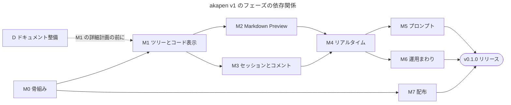

# akapen 実装計画 (v1)

**目的: akapen v1 を M0〜M7 の 8 フェーズで実装し、mise で配布できる単一バイナリとしてリリースするまでの道筋・各フェーズの完了条件・リスクを定める。**

- 作成日: 2026-10-23
- 対象: v0.1.0 (v1 の初回リリース)
- フェーズごとの詳細計画 (TDD の手順まで落としたもの) は、着手時に `docs/plan/M<N>_<名前>_詳細計画.md` として 1 本ずつ書く。作成済み: [M0_骨組み_詳細計画.md](./M0_骨組み_詳細計画.md)
- 要件と設計の正本は `docs/design/` ([要件.md](../design/要件.md) / [全体設計.md](../design/全体設計.md) から辿る)、技術調査の正本は `docs/research/` (2026-10-23 の D1 / D2 で移した)

***

## 目的

対象ディレクトリのドキュメントとコードを複数人がブラウザで閲覧し、行・ブロック単位でコメントとリプライを付け、そのスレッドを Coding Agent 向けのプロンプトとしてコピーできるようにする。

v1 で達成すること:

- `akapen [dir]` 1 コマンドで起動し、同じ tailnet 内の同僚とリアルタイムにレビューできる
- コメントはセッション単位で `~/.config/akapen/` に永続化され、同じディレクトリで再起動すれば続きから使える
- 対象ディレクトリのファイルは一切書き換えない
- GitHub Releases の単一バイナリを `mise use github:<owner>/akapen` で入れられる

***

## スコープ

### 機能要件とフェーズの対応

要件 ID は [要件.md](../design/要件.md) の番号。

| ID | 要件 | フェーズ |
|----|------|---------|
| F1 | Bun で動く CLI。カレントか引数のディレクトリをルートとして起動 | M0 |
| F2 | ブラウザから Web アプリにアクセス | M0 |
| F3 | 初回アクセス時に Nickname を入力 | M3 |
| F4 | 左に File Tree (`.gitignore` の対象は非表示) | M1 |
| F5 | 選んだファイルを右ペインに表示。URL ハッシュで共有可能 | M1 |
| F6 | Markdown は Preview 表示 (行範囲を保持) | M2 |
| F7 | Markdown 中の Mermaid を図として表示 | M2 |
| F8 | Markdown 以外は GitHub 風のコードハイライト | M1 |
| F9 | 行 (Source 表示) / ブロック (Preview 表示) を選んでコメント | M3 (Source) / M4 (Preview) |
| F10 | 参加者全員でコメント・リプライ・Resolve | M3 (REST) / M4 (即時配信) |
| F11 | コメントをセッション単位で永続化 | M3 |
| F12 | Coding Agent 向けプロンプトを生成してコピー。`akapen export` | M5 |
| F13 | セッションの終了と削除 | M6 |
| A1 | ファイル変更の監視とライブ更新 | M6 |
| A2 | コメント位置の追従と Outdated 表示 | M6 |
| A3 | 送信済み (Sent) の区別 | M5 |
| A4 | プレゼンス表示 | M4 |

非機能要件のうち、バイナリ・巨大ファイルの表示は要件メモでは M6 に置かれていたが、ファイル表示の一部なので **M1 に移す** (M1 の時点でバイナリを開いて画面が壊れないようにするため)。

### 技術スタック (決定済み)

| 領域 | 採用 | 根拠 |
|------|------|------|
| ランタイム / サーバー | Bun 1.4.4 の `Bun.serve` (HTML import + WebSocket pub/sub) | フロントエンドのバンドルと WebSocket が組み込みで、`bun build --compile` で単一バイナリにできる |
| フロントエンド | React 19 + TypeScript | Bun が TSX と CSS を直接バンドルできる |
| Markdown | markdown-it 15 | ブロックトークンの `map` で行範囲が取れる。`Bun.markdown` はソース位置を返さないため不採用 |
| コードハイライト | Shiki 4 (`github-light` / `github-dark`) | VS Code と同じ文法で GitHub に近い見た目 |
| 図 | Mermaid 12 (クライアントで動的 import) | DOM が必要なためブラウザで描画 |
| サニタイズ | DOMPurify 3 (クライアント) | サーバー側に DOM 実装を持たずに済む |
| 永続化 | `bun:sqlite` (WAL) をセッションごとに 1 ファイル | 組み込み。編集・Resolve・削除を素直に書ける |
| 設定 | `Bun.TOML.parse` | 組み込み。依存が増えない |
| gitignore 判定 | `git ls-files --cached --others --exclude-standard -z` (Git 管理外は `ignore` 7) | Git と完全に同じ判定になる |
| 型チェック / フォーマット / テスト | `bun check` / `bun fmt` / `bun test` | Bun 1.4.4 に組み込み。`typescript` や Biome / Prettier を入れずに済む (2026-10-23 に `bun check --help` / `bun fmt --help` で確認)。`bun fmt` は Markdown も整形するため、対象は `src` / `test` に限る |

ランタイム依存はサーバー側 `markdown-it` / `shiki` / `ignore`、クライアント側 `react` / `react-dom` / `mermaid` / `dompurify` に限る。これ以外を足すときは ADR で理由を残す。

### ソースの構成 (予定)

責務ごとにディレクトリを分ける。ファイル単位の分割は各フェーズの詳細計画で確定する。

```text
src/
├── cli.ts            # エントリーポイント、サブコマンドの振り分け (M0, M5, M6)
├── args.ts           # 引数解析 (M0)
├── root.ts           # ルートの解決 (M0)
├── server.ts         # Bun.serve の組み立て (M0〜)
├── files/            # FileIndex、パスの検証 (M1)
├── render/           # Shiki、markdown-it と行マッピング (M1, M2)
├── session/          # 保存先、session.json、ロック、prune (M3, M6)
├── review/           # SQLite スキーマ、スレッド / コメント、再アンカー (M3, M6)
├── realtime/         # WebSocket のトピック配信、プレゼンス (M4)
├── prompt/           # プロンプト整形、JSONL 出力 (M5)
├── watch/            # ファイル監視 (M6)
├── config/           # config.toml の読み込みと検証 (M6)
├── shared/           # サーバーとクライアントで共有する API / イベントの型
└── web/              # React SPA
test/                 # ビルド・結合テスト
```

***

## 非スコープ

v1 では次を扱わない (要件メモのスコープ外をそのまま引き継ぐ)。

- ファイルの編集・保存
- リモートアクセス・認証・HTTPS 終端 (Tailscale などに任せる。README で `tailscale serve` を案内するのみ)
- Git の diff 表示・コミット単位のレビュー
- Coding Agent との直接連携 (MCP サーバー、Claude Code スキル、Agent からスレッドへの返信)
- 英語以外の UI、プロジェクト単位の設定ファイル (`.akapen.toml`)
- 複数ルートの同時オープン、サブモジュール内部の展開、Windows
- mise registry の短縮名 (`mise use akapen`) への登録

***

## 完了条件

v1 (v0.1.0) は次をすべて満たしたら完了とする。

1. F1〜F13 と A1〜A4 が各フェーズの完了条件を満たして動く
2. `bun run verify` (型チェック・フォーマット・テスト) が CI の macOS と Linux で通る
3. 性能目標を計測して記録している: ファイル数 2 万のツリー表示が 1 秒以内 / 10 クライアントの同時接続でイベントが全員に届く
4. 読み取り専用であることをテストで確認している: 一連の操作 (起動 → 閲覧 → コメント → export → 終了) の前後で、対象ディレクトリのファイルの内容と mtime が変わらない
5. v0.1.0 が GitHub Releases にあり、別の Mac で `mise use -g github:<owner>/akapen@0.1.0 && akapen --version` が `0.1.0` を出す
6. README に使い方・設定ファイル・`tailscale serve` での共有方法が書かれている

***

## タスク分解

### フェーズの依存関係



- M2 と M3 は M1 の後に並行して進められる
- M7 のリリースパイプラインは M0 の後ならいつでも作れる。mise の自動判定や Gatekeeper など要検証の項目が多いため、前倒しを推奨する (リスク R5)

### 共通ルール

- 各フェーズは「詳細計画を書く → タスクごとに TDD (テスト → 失敗の確認 → 実装 → 成功の確認 → commit)」で進める
- 純粋なロジック (プロンプト整形、行マッピング、ignore 判定、prune、再アンカー、設定の検証) は単体テストを厚くする。HTTP / WebSocket は `Bun.serve` を port 0 で起動して `fetch` / `WebSocket` で結合テストする
- フェーズの完了時に `bun run verify` を通し、`bun run build` で作ったバイナリで手動確認する

### D: ドキュメント整備 (M0 と並行、M1 の詳細計画より前)

M1 以降の詳細計画は設計書を前提にするため、先に要件と調査をリポジトリに移す。

| # | タスク | 成果物 |
|---|--------|--------|
| D1 (完了) | 技術調査を確認日付きで移す | `docs/research/` (Bun、Markdown パーサー比較、Shiki、Mermaid、gitignore 判定、Tailscale 経由の制約、mise 配布、類似ツール) |
| D2 (完了) | 要件と設計をトピックごとに移す | `docs/design/` (要件、全体設計、ファイル一覧と表示、Markdown Preview、API、セキュリティ、保存先とセッション、データモデル、プロンプト出力仕様、CLI 仕様、設定ファイル、画面構成、配布) |
| D3 | 後戻りコストの高い決定を ADR にする | `docs/adr/` (単一バイナリと Bun の採用 / markdown-it の採用 / 保存先とセッション単位の SQLite / gitignore 判定を Git に委ねる / mise の `github:` で配布) |
| D4 | `docs/AGENTS.md` と `docs/README.md` を akapen 向けに直す | 現在の本文は別プロジェクト (Go の SDK) 向けのままで、プロジェクト概要・設計書の書き分けが akapen に合っていない |

### M0: 骨組み

- **対象**: F1, F2
- **詳細計画**: [M0_骨組み_詳細計画.md](./M0_骨組み_詳細計画.md)
- **タスク**
  1. 雛形 (`package.json` / `tsconfig.json` / `.gitignore`、`mise.toml` で Bun を 1.4.4 に固定) と CLI 引数の解析 (`parseArgs`)
  2. ルートディレクトリの解決 (realpath、存在とディレクトリであることの確認)
  3. `Bun.serve` + HTML import + `GET /api/health`、React の最小画面。既定ポートが使用中なら次の空きポート
  4. CLI エントリーポイントと `bun run build` (単一バイナリ)、ビルドのスモークテスト
- **完了条件**
  - `bun run verify` が通る
  - `dist/akapen --version` がバージョンを出す
  - `dist/akapen <dir>` で `http://127.0.0.1:4400/` に画面が出る。4400 が使用中なら 4401 以降で起動する
  - `--port` を明示したポートが使用中ならエラーで終了する (黙って別ポートに移らない)

### M1: ツリーとコード表示

- **対象**: F4, F5, F8、バイナリ・巨大ファイルの表示
- **タスク**
  1. FileIndex: `git ls-files ... -z` の結果から、作業ツリーに存在しないファイルを除いて一覧を作る。Git 管理外 (または `git` が無い) ときは各階層の `.gitignore` を `ignore` で積み上げて判定する。`.git/` は常に除外する
  2. パスの検証: 一覧に含まれるパスだけを配信する。`..` やシンボリックリンクでルートの外を指すものは拒否する
  3. `GET /api/tree` と File Tree の UI (折りたたみ、ハッシュルーティング `#/doc/<path>`)
  4. `GET /api/file?path=`: Shiki のデュアルテーマでハイライトし、行の配列とともに返す。`(path, mtime)` でキャッシュする。ファイル名から言語への対応表 (`Dockerfile`、`mise.toml`、`.env` など) を持ち、不明なものは `text` にする
  5. 画像は `` で表示、その他のバイナリは "Binary file not shown"、2MB 超はハイライトなしで表示
  6. Shiki の読み込みを `shiki/core` + 使う言語に絞り、バイナリサイズへの効果を測って決める (調査時の試作は全言語込みで約 114MB)
- **完了条件**
  - 調査で確認した gitignore の 7 ケース (ルート / サブディレクトリの `.gitignore`、`git add -f` 済み、`.git/info/exclude`、未追跡、削除済み、サブディレクトリをルートにした場合) がテストになっていて通る
  - ルート外を指すパス・シンボリックリンクへのリクエストが 404 になるテストがある
  - 2 万ファイルの生成リポジトリで、`/api/tree` の応答とツリーの描画が合わせて 1 秒以内 (超える場合は `@tanstack/react-virtual` の追加を ADR で検討)

### M2: Markdown Preview

- **対象**: F6, F7
- **タスク**
  1. markdown-it のレンダラーを拡張し、`heading_open` / `paragraph_open` / `list_item_open` / `tr_open` / `blockquote_open` / `fence` / `code_block` / `hr` / `html_block` に `data-src-start` / `data-src-end` (1 始まり・両端を含む) を付ける。末尾の空行は範囲から除く
  2. タスクリストの自前ルール、`linkify`
  3. 言語 `mermaid` のフェンスを `<div class="mermaid">` に変換し、クライアントで Mermaid を動的 import して描画する (`securityLevel: 'strict'`)
  4. クライアントで DOMPurify によりサニタイズする。`data-src-*` 属性が残ることを確認する
  5. `Preview | Source` のタブ切り替え
- **完了条件**
  - 調査で実測した `map` のサンプル (見出し・複数行の段落・ネストしたリスト・表・Mermaid・引用) について、期待する `data-src-*` が付くことをテストで確認している
  - `<script>` や `javascript:` の href を含む Markdown を開いても実行されない
  - Mermaid を含まないファイルを開いたときに Mermaid のチャンクを読み込まない

### M3: セッションとコメント

- **対象**: F3, F9 (Source 表示), F10 (REST まで), F11
- **タスク**
  1. 保存先の解決 (`AKAPEN_HOME` > `$XDG_CONFIG_HOME/akapen` > `~/.config/akapen`)。ディレクトリは `0700`、ファイルは `0600`。`sessions/.gitignore` (中身は `*`) を作る
  2. `session.json` (schemaVersion、id、root、status、各日時)。起動時に同じ root の active を再開し、無ければ新規作成する。`--new` / `--session <id>`
  3. `server.lock` による多重起動の防止 (pid が生きていて `/api/health` が同じセッション ID を返したら、既存の URL を出して終了する)
  4. `review.db` (threads / comments、WAL、`PRAGMA user_version` によるマイグレーション)
  5. スレッドとコメントの REST API (作成・リプライ・編集・削除・Resolve / Reopen)。編集と削除は自分の `client_id` のコメントだけ。`anchor_text` と `file_sha` はサーバーが元ファイルから作る
  6. Nickname のモーダルと `localStorage`。`client_id` は `crypto.getRandomValues()` で作る (`crypto.randomUUID()` は安全なコンテキストでしか使えないため)
  7. Source 表示での行選択 (クリック / Shift+クリック / ドラッグ)、行の直下へのスレッドのインライン表示、File Tree の未解決数バッジ
  8. `lastActiveAt` の更新 (1 分に 1 回まで)。ended のセッションでは書き込み API を拒否する
- **完了条件**
  - サーバーを再起動しても同じルートならスレッドが残っている。`--new` では空のセッションになる
  - 同じルートで 2 回起動すると、2 回目は既存の URL を出して終了する
  - 他人の `client_id` のコメントを編集・削除できない
  - 作成されたファイルのパーミッションが `0700` / `0600` である

### M4: リアルタイム

- **対象**: F9 (Preview 表示), F10 (即時配信), A4
- **タスク**
  1. `/ws` の WebSocket。upgrade の前に `Origin` を検証する。トピック `review` で全員に配信する
  2. イベントの型を `src/shared/` に定義する (`thread.*` / `comment.*` / `session.ended` / `presence.changed`)。REST の書き込みの後にサーバーが配信する
  3. クライアントの小さなストア (`useSyncExternalStore`)。再接続時はスレッドを取り直して整合させる
  4. プレゼンス: ヘッダーに接続中の参加者、File Tree に閲覧中の参加者
  5. Preview 表示のブロックコメント: ホバーで最も内側の `data-src-*` 要素に「+」を出す。Shift+クリックで複数ブロックに広げる。スレッドはブロックの直下に表示する
- **完了条件**
  - 2 つの WebSocket クライアントのテストで、片方の操作がもう片方に届く
  - 不正な `Origin` の upgrade が拒否される
  - 10 クライアントを同時に接続するスクリプトで、全員にイベントが届く
  - `tailscale serve` 経由で WebSocket がつながることを手動で確認している (調査では要検証)

### M5: プロンプト

- **対象**: F12, A3
- **タスク**
  1. プロンプトの整形 (純粋関数): 並び順 (ツリー順 → 開始行)、`path:3` / `path:8-10`、選択行の 2 スペースのインデント、複数行コメントの ` by {Nickname}` の位置、`max_anchor_lines` を超えたときの省略、` (outdated)`、`preamble`
  2. Review パネル: Open / Resolved / Sent のフィルタ、対象スレッドの選択 (既定: 未解決すべて)、生成とコピー
  3. コピー: `navigator.clipboard.writeText()` → 非表示 textarea + `execCommand('copy')` → 全文を選択済みの textarea をモーダル表示、の順に試す
  4. コピー時に `exported_at` を記録して Sent バッジを出す。"Resolve copied threads" のチェックボックス
  5. `akapen export [dir] --session --status --format prompt|jsonl` (サブコマンドの振り分けを `cli.ts` に足す)。サーバーの起動中でも読めるよう、SQLite に `busy_timeout` を設定する
- **完了条件**
  - 設計書の出力例をそのまま期待値にしたゴールデンテストが通る (単一行・範囲・リプライ・複数行コメント・省略・outdated)
  - `http://` の Tailscale IP でアクセスしたブラウザでもコピー (またはモーダルからの手動コピー) ができる
  - `akapen export | pbcopy` で UI のコピーと同じ文字列が得られる

### M6: 運用まわり

- **対象**: F13, A1, A2、設定ファイル
- **タスク**
  1. `akapen session ls / end / reopen / rm / prune [--dry-run]`。起動中 (ロック中) のセッションは消さない
  2. 起動時の自動処理: `idle_days` を過ぎた active を ended にし、`ended_days` を過ぎた ended を削除する。削除したら 1 行ログを出す
  3. UI の End session (確認モーダルでコピー / JSONL の書き出しを案内)、全員への `session.ended` と read-only のバナー
  4. `config.toml`: 優先順位 (CLI フラグ > 環境変数 > `config.toml` > 既定値)、未知のキーは警告、型の違いはキーのパス付きで起動を止める。`akapen config init / path / show`。`viewer.exclude` を FileIndex に反映する
  5. ファイル監視: `fs.watch` (recursive) + デバウンスで `file.changed` / `tree.changed` を配信する。追加・削除で FileIndex を作り直す。`--no-watch`
  6. 再アンカー: ファイルが変わったら、スレッドの `anchor_text` を元の位置の近くから探し直して行番号を更新する。見つからなければ Outdated にする
- **完了条件**
  - prune の判定 (idle / ended の日数、`0` で無効、ロック中は対象外、ルートが消えたセッション) が単体テストで固まっている
  - 設定の優先順位と検証エラーがテストで確認されている
  - 行の挿入・削除・行内の編集・該当行の削除のそれぞれで、再アンカーが期待どおりに動く (最後のケースは Outdated になる)
  - macOS と Linux の両方でファイル監視が動く (調査では要検証)

### M7: 配布

- **対象**: 配布の非機能要件
- **タスク**
  1. GitHub リポジトリの作成 (当面は private)。push 時の CI (`bun run verify` を macOS と Linux で実行)
  2. タグ `v*` で動くリリースワークフロー: `linux-x64` / `linux-arm64` は Linux ランナーでクロスコンパイル、`darwin-arm64` は macOS ランナーでビルドし `codesign` で署名 (JIT 用の entitlements 付き)
  3. `akapen-v<version>-<os>-<arch>.tar.gz` と `checksums.txt` を Release に置く。タグと `package.json` の `version` の一致を CI で確認する
  4. `mise use github:<owner>/akapen@<version> && akapen --version` のスモークテスト
  5. README (使い方、設定ファイル、`tailscale serve` での共有、private リポジトリから入れるときのトークン設定)
  6. public にした後: artifact attestation と packslip (`jdx/packslip@v1`) を追加する
- **完了条件**
  - 完了条件 5 (別の Mac での `mise use`) を満たす
  - mise で入れたバイナリで Gatekeeper の警告が出ない (調査では要検証)

***

## リスク

| # | リスク | 影響 | 対応 |
|---|--------|------|------|
| R1 | Bun 1.4 は本体を Rust で書き直した最初の系列 (2026-08) で、退行の可能性がある | 機能が動かない・バージョンごとに挙動が変わる | `mise.toml` で 1.4.4 に固定する。上げるときは `bun run verify` とビルドのスモークテストで確認する |
| R2 | コンパイルしたバイナリは、既定で実行時のカレントディレクトリの `.env` と `bunfig.toml` を読む | レビュー対象のプロジェクトの `.env` (秘密情報を含みうる) が akapen の環境変数に入る | `--no-compile-autoload-dotenv --no-compile-autoload-bunfig` を付けてビルドする (M0 で対応済み。2026-10-23 に手元で再現と回避を確認) |
| R3 | 認証のない HTTP サーバーがソースコードを配信する | 悪意あるサイトからの CSRF でコメントが書き込まれる。DNS rebinding で `/api/file` が読まれる | 要件にあるのは WebSocket の `Origin` 検証のみ。REST の書き込みにも `Origin` 検証を、全リクエストに `Host` ヘッダーの許可リストを適用することを提案する (未決事項 U3) |
| R4 | `fs.watch` の recursive が macOS / Linux で期待どおりに動くか、大量ファイルでの負荷が未検証 | A1 / A2 が動かない | M6 の最初にスパイクで確認する。だめならディレクトリごとの監視かポーリングに切り替える |
| R5 | mise のアセット自動判定と Gatekeeper の挙動が未検証 | リリースしても入らない・起動時に警告が出る | M0 の直後に v0.0.1 を private リポジトリでリリースし、M7 の検証項目を前倒しで潰す |
| R6 | Shiki の全言語を含めるとバイナリが約 114MB になる | ダウンロードと起動が重い | M1 で `shiki/core` + 言語の絞り込みを測って決める |
| R7 | Mermaid 12 で既定値の変更があり、`securityLevel: 'strict'` の扱いも未検証 | 図の崩れ・サニタイズ漏れ | M2 で v12 の変更点を確認してから組み込む |
| R8 | `tailscale serve` 経由で WebSocket が通るか未検証 | リアルタイム更新が tailnet 越しに動かない | M4 で手動確認する。通らなければ README で `--host` での直接接続を案内する |
| R9 | 再アンカー (A2) の精度 | 誤った行にコメントが付く | 迷ったら Outdated に倒す (誤って付け替えるより安全)。代表的な編集パターンを単体テストにする |
| R10 | サーバーと `akapen export` / `session` が同じ SQLite を同時に開く | `SQLITE_BUSY` | WAL + `busy_timeout` を設定する。書き込みはサーバー経由かロックの確認を挟む |
| R11 | サブコマンド名 (`export` / `session` / `config`) と同名のディレクトリを開けない | `akapen export` がディレクトリとして解釈されない | `akapen ./export` で開けることを README に書く |

***

## 未決事項

要件メモから引き継いだもの:

- [x] GitHub リポジトリの作成 → `dannygim/akapen` を private で作成済み。public にする時期は未定 (public にするかはリポジトリの持ち主が決める)
- [x] 保持期間の既定値 → `idle_days = 60` / `ended_days = 14` ([設定ファイル.md](../design/設定ファイル.md))
- [x] プロンプトの前置きと省略閾値の既定値 → 前置きは空、`max_anchor_lines = 30` ([プロンプト出力仕様.md](../design/プロンプト出力仕様.md))
- [x] コピー時の自動 Resolve → 既定は OFF (`resolve_on_copy = false`)
- [x] `Tailscale-User-Login` による Nickname の自動入力 → v1 では行わない (v2 候補。[要件.md](../design/要件.md))

本計画で新たに出たもの (2026-10-23 に D2 で決定):

- [x] U1: `--port` / `AKAPEN_PORT` / `config.toml` の `server.port` のいずれかで明示したら、空きポートに移らない ([CLI_仕様.md](../design/CLI_仕様.md))
- [x] U2: 先頭 `ceil((max - 1) / 2)` 行と末尾 `floor((max - 1) / 2)` 行を残し、省略の 1 行と合わせて `max` 行にする ([プロンプト出力仕様.md](../design/プロンプト出力仕様.md))
- [x] U3: v1 に入れる。`Host` ヘッダーの許可リスト + 書き込みと WebSocket のトークン + WebSocket の `Origin` 検証 ([セキュリティ.md](../design/セキュリティ.md))
- [x] U4: ハイライトする ([Markdown_Preview.md](../design/Markdown_Preview.md))
- [x] U5: `Bun.WebView` を使う ([全体設計.md](../design/全体設計.md))
- [x] U6: CI (`bun run verify` を macOS / Linux で実行) だけを前倒しし、D の直後に入れる。リリースのパイプラインは M7 のまま ([配布.md](../design/配布.md))

***

## 出典

> 出典: [Bun 1.4](https://bun.com/blog/bun-v1.4) (確認日: 2026-10-23)

> 出典: [Bun — Single-file executable](https://bun.com/docs/bundler/executables) (確認日: 2026-10-23)

> 出典: [Bun — Fullstack dev server](https://bun.com/docs/bundler/fullstack) (確認日: 2026-10-23)

> 出典: [Bun — WebSockets](https://bun.com/docs/runtime/http/websockets) (確認日: 2026-10-23)

> 出典: [Bun — SQLite](https://bun.com/docs/runtime/sqlite) (確認日: 2026-10-23)

> 出典: [Shiki v4](https://shiki.style/blog/v4) (確認日: 2026-10-23)

> 出典: [MDN — Clipboard](https://developer.mozilla.org/en-US/docs/Web/API/Clipboard) (確認日: 2026-10-23)

> 出典: [Tailscale Serve](https://tailscale.com/docs/features/tailscale-serve) (確認日: 2026-10-23)

> 出典: [mise — GitHub backend](https://mise.jdx.dev/dev-tools/backends/github.html) (確認日: 2026-10-23)

> 出典: [mise — packslip backend](https://mise.jdx.dev/dev-tools/backends/packslip.html) (確認日: 2026-10-23)

> 出典: [GitHub Docs — Using artifact attestations](https://docs.github.com/en/actions/how-tos/secure-your-work/use-artifact-attestations/use-artifact-attestations) (確認日: 2026-10-23)
